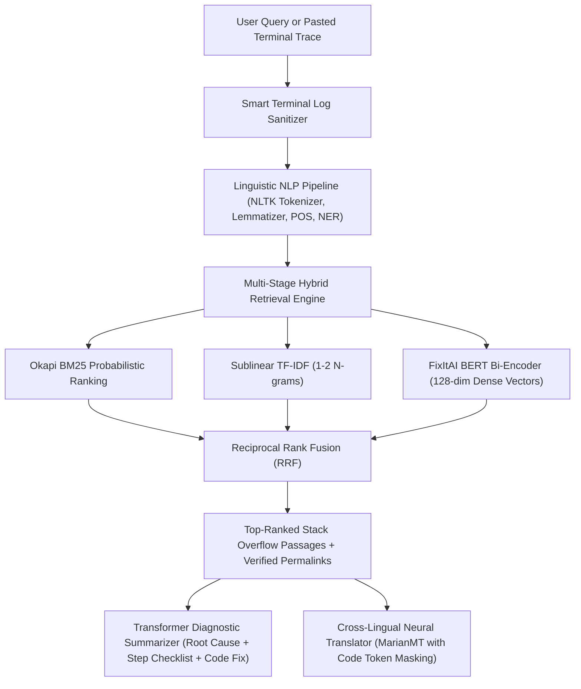

# FixItAI

FixItAI is a local, offline technical diagnostic and information retrieval workspace. It features a modern React + Vite frontend, a FastAPI REST backend, multi-stage Information Retrieval with Reciprocal Rank Fusion (RRF), an extractive Transformer diagnostic summarizer, an English-to-Hindi vernacular diagnostic engine, and thread-safe persistence.

It is indexed with **100,000+ top-voted Stack Overflow technical Q&As** with full source grounding, answer permalinks, and interactive guided troubleshooting.

---

## Key Features

1. **100,000+ Precomputed Stack Overflow Dataset**:
   - Extracted and verified from the official Stack Overflow archive (`Questions.csv`, `Answers.csv`, `Tags.csv`).
   - Combined with curated starter guides (`100,022 total passages`).
   - Pre-embedded with FixItAI BERT into vector embeddings (`passage_embeddings.npz`) for instant (<15ms) search.

2. **Grounded Source Attribution & Live Permalinks**:
   - Every reference passage links directly to the authentic thread:
     - **Open source discussion**: `https://stackoverflow.com/a/<answer_id>` (direct link to top-voted answer).
     - **Original inquiry**: `https://stackoverflow.com/questions/<question_id>` (link to original question).
     - **Author citation**: `Stack Overflow question #<qid> · answer #<aid>`.

3. **Multi-Ecosystem Terminal Crash Log Parser**:
   - Automatically sanitizes and extracts the root cause from raw multi-line terminal dumps:
     - **Python**: Scans from bottom up for active exceptions, strips local paths, and isolates the crashing frame.
     - **Java / JVM**: Prioritizes `Caused by:` lines over generic wrapper exceptions.
     - **Node.js / JS**: Detects module resolution errors (`Cannot find module ...`).
     - **Docker**: Detects daemon failure responses (`bind: address already in use`, port conflicts).
     - **Git / Compilers**: Isolates fatal ref rejections and compiler errors without capturing shell prompts (`user@host %`).
   - Works seamlessly in both the dedicated **Terminal Log Parser** and by pasting directly into the **main search box**.

4. **Hardware-Adaptive Acceleration (NVIDIA CUDA + Apple Silicon MPS + CPU)**:
   - **HP Victus & NVIDIA GPUs:** Accelerated via PyTorch CUDA 12.x with automatic FP16 Tensor Core mixed-precision (`torch.autocast("cuda", dtype=torch.float16)`).
   - **macOS (M1/M2/M3/M4):** Accelerated via PyTorch Metal Performance Shaders (MPS).
   - **CPU:** Vector-optimized float32 BLAS matrix dot-product inference.

5. **Dynamic Guided Troubleshooting Wizard**:
   - Clarifying questions generated contextually from query and retrieval results.
   - Dynamically refines diagnostics, actionable checklists, and code snippets based on selected scenario options.

---

## System Requirements & Portability

- **macOS:** Apple Silicon (M1/M2/M3/M4) or Intel, macOS 12+
- **Windows / HP Victus:** Windows 10/11 with NVIDIA GeForce RTX GPU (RTX 3050, 4050, 4060, etc.)
- **Linux:** Ubuntu 20.04+, Debian, Fedora with or without CUDA

---

## Quickstart

### 1. Install Backend Dependencies

#### macOS / Linux
```bash
python3 -m venv .venv
source .venv/bin/activate
pip install -r requirements.txt
```

#### Windows / HP Victus (with CUDA GPU Acceleration)
```powershell
python -m venv .venv
.\.venv\Scripts\Activate.ps1
# Install PyTorch with CUDA 12.4 support:
pip install torch torchvision --index-url https://download.pytorch.org/whl/cu124
pip install -r requirements.txt
```

---

### 2. Start the Application

You can run the frontend and backend together or independently:

#### Option A: Development Mode (Hot Reloading)
- **Terminal 1 (Backend):**
  ```bash
  source .venv/bin/activate  # or .\.venv\Scripts\Activate.ps1 on Windows
  uvicorn api:app --reload --host 127.0.0.1 --port 8000
  ```
- **Terminal 2 (Frontend):**
  ```bash
  cd frontend
  npm install
  npm run dev
  ```
  Open `http://localhost:5173` in your browser.

#### Option B: Terminal CLI (Direct Command Line or Stdin Pipe)
You can run diagnostics directly from your command line without starting the web UI:
```bash
# Direct diagnostic query:
python fixit.py "Python ModuleNotFoundError: No module named 'fastapi'"

# Pipe crashing script output directly:
python app.py 2>&1 | python fixit.py

# Specify regional language (e.g. Hindi, Marathi):
python fixit.py "Java NullPointerException" --lang hi
```

#### Option C: Production Mode (FastAPI serves compiled React bundle)
```bash
cd frontend
npm run build
cd ..
uvicorn api:app --host 127.0.0.1 --port 8000
```
Open `http://127.0.0.1:8000` in your browser.

---

### 3. Re-indexing & Dataset Management

FixItAI comes pre-indexed with **100,022 passages** in `models/fixitai_bert_200k/indexed_chunks.json` and precomputed embeddings in `passage_embeddings.npz`.

If you ever wish to re-index or adjust the dataset size from `data/archive/`:
```bash
# Index top 100,000 Q&As with score >= 4 (takes ~2 minutes on GPU/MPS):
python scripts/index_stackoverflow.py 100000
```

---

## Automated Tests

Run the complete test suite with `pytest`:
```bash
pytest
```
All 18 unit tests cover:
- Linguistic parsing, tokenization, lemmatization vs. stemming
- Terminal log parsing and stack trace sanitization
- Multi-modal retrieval and Reciprocal Rank Fusion
- Domain guardrails and Guided Wizard scenario resolution
- Persistence and history management

---

## Architecture & Neural Information Retrieval



### Fusion Formula (RRF)
$$RRF(d) = \sum_{m \in \{\text{TF-IDF}, \text{BM25}, \text{Dense}\}} \frac{w_m}{k + \text{rank}_m(d)}$$
Where $k=60$ acts as a rank smoothing parameter to eliminate score scale discrepancies between sparse and dense scores.

---

## Dataset Attribution & Licensing

- **Stack Overflow Archive**: Posts from `Questions.csv`, `Answers.csv`, and `Tags.csv` are licensed under **Creative Commons Attribution-ShareAlike (CC BY-SA)**.
- FixItAI retains verified post IDs, author links, and attribution in all search results. Review CC BY-SA guidelines before commercial redistribution.
